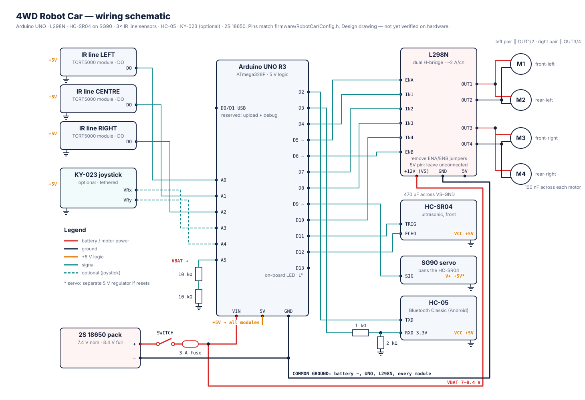

# 4WD Robot Car

[](https://github.com/YOUR-USERNAME/4WD-Robot-Car/actions/workflows/tests.yml)

**[Project page →](https://YOUR-USERNAME.github.io/4WD-Robot-Car/)**

An Arduino UNO four-wheel-drive robot with **line following**, **ultrasonic obstacle avoidance**, **Bluetooth phone control** and optional **joystick control**, built on a Robocentrix 4WD kit with custom modular firmware.

> **Status:** firmware written and logic-tested in a host simulator (92/92 checks pass). **Hardware not yet assembled or tested.** Every physical result in this repo will come from `docs/testing-guide.md` once the robot is built. Nothing is claimed before then.



## Features
| Mode | Key | What it does |
|---|---|---|
| Line following | `T` | 3 IR sensors, soft/hard corrections, gap tolerance, search, then `LINE_LOST` fault. Pauses for obstacles on the track |
| Obstacle avoidance | `O` | Cruise → stop at 20 cm → reverse → servo scan left/right → turn to the clearer side → re-check. `BOXED_IN` fault after 4 retries |
| Bluetooth manual | `M` | `F B L R` + diagonals, speed `0`–`9`/`q`. Hold-to-drive with a 600 ms link-loss stop. Collision guard blocks forward driving into obstacles |
| Joystick | `K` | Tethered KY-023, proportional speed, dead-zone stop, input validation |
| Emergency stop | `E` | Instant motor cut-off from any mode |

Safety built in: one module owns the motors, every mode change ramps to a stop first, faults latch until cleared, a debounced low-battery cut-off at 6.4 V, and validated sensor readings (stuck or missing echo, joystick wire off, robot lifted).

## Hardware
Arduino UNO R3 · L298N dual H-bridge · 4× TT gear motors (skid-steer, two per channel) · HC-SR04 on an SG90 servo · 3× TCRT5000 line sensors · HC-05 (Android; HM-10 for iPhone) · 2S 18650 pack (7.4 V) with switch and 3 A fuse.
See [shopping list](docs/shopping-list.md) and [design + electrical checks](docs/01-phase1-design.md).

## Firmware architecture
```
CommandInput (BT + USB) ─┐
JoystickInput ───────────┤
LineSensors → LineFollower ┼─► ModeManager ─► safety filter ─► Motors ─► L298N
Ultrasonic + Scanner → ObstacleAvoider ┘      (sole owner)     (ramping)
Battery ───────────────────────────────────────┘
```
All pins and thresholds are in [`Config.h`](firmware/RobotCar/Config.h). The loop is non-blocking (`millis()` everywhere); the only bounded wait is the ultrasonic echo (≤ 9 ms every 60 ms).

## Repository
| Path | Contents |
|---|---|
| `firmware/RobotCar/` | Main Arduino sketch (open `RobotCar.ino`) |
| `firmware-tests/` | 7 single-purpose bench sketches: motors, line, ultrasonic, servo, Bluetooth, joystick, battery |
| `simulation/host-tests/` | Mock Arduino core + 92 logic tests, run with `./run_tests.sh` |
| `simulation/wokwi/` | Browser simulation layout (LEDs stand in for the motor driver) |
| `docs/` | Wiring, circuit diagram, assembly, upload, testing, troubleshooting, demo checklist |
| `website/` | Portfolio presentation page (placeholders until real photos/video exist) |
| `media/` | Real photos and videos of this robot only |

## Quick start
1. Read [wiring](docs/wiring.md) and build with the [assembly guide](docs/assembly-guide.md).
2. Run the logic tests: `cd simulation/host-tests && CXX=clang++ ./run_tests.sh`
3. [Upload](docs/upload-instructions.md) each `firmware-tests` sketch in order, then `firmware/RobotCar`.
4. Work through the [testing guide](docs/testing-guide.md) and record real results.
5. Stuck? See [troubleshooting](docs/troubleshooting.md). Presenting? Use the [demo checklist](docs/demo-checklist.md).

## Safety
Never power motors from Arduino pins. Join all grounds. Remove the ENA/ENB jumpers. Charge 18650 cells individually in a proper charger, never unattended. Wheels off the ground for every first test.

## Possible next steps
Wheel encoders (the kit includes encoder discs) for closed-loop speed · PID line following with analog sensor outputs · TB6612FNG driver · wireless handheld joystick (second Arduino + HC-05 master sending the same command characters).
