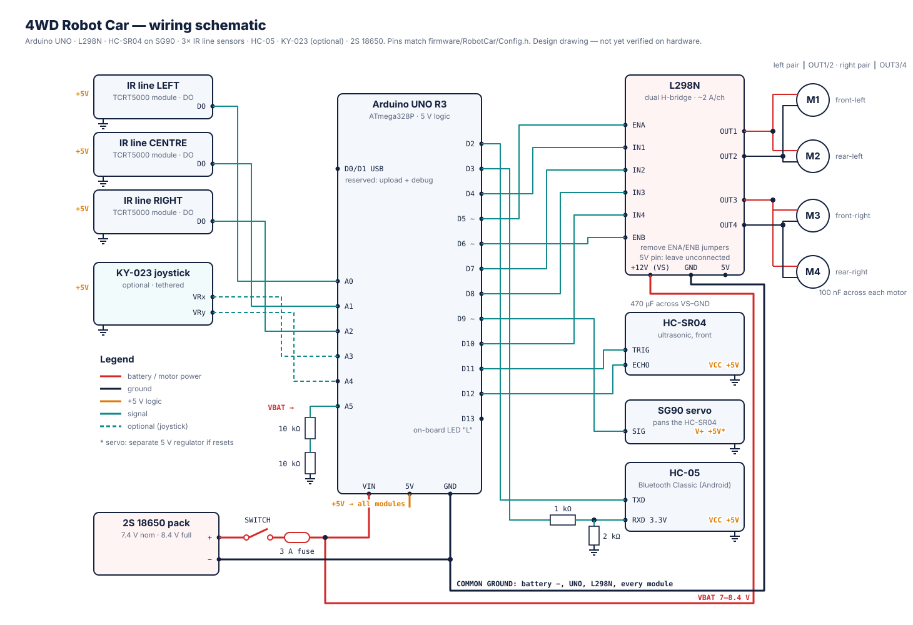

# Wiring

Status: **design, not yet verified on hardware.** Check each connection against this page, `Config.h` and a multimeter before the first power-up.



The diagram is generated from `docs/tools/make_circuit_svg.py`. If you change a pin in `Config.h`, update the script and this table too.

---

## 1. Power distribution

```
 2S 18650 (7.4 V nom, 8.4 V full)
   +  ──► SWITCH ──► 3 A FUSE ──►●── VBAT ──┬──► L298N  +12V (VS)   ── motors
                                 │          ├──► Arduino VIN  (on-board 5 V regulator)
                                 │          └──► 10 kΩ ─┬─ 10 kΩ ─► GND
                                 │                      └─► A5 (battery sense, ≤ 4.2 V)
   −  ───────────────────────────●── GND ── L298N GND ── Arduino GND ── every module GND

 Arduino 5V pin ──► HC-SR04 VCC, 3× line sensor VCC, HC-05 VCC, joystick +5V, servo V+*
 L298N 5V pin  ──► NOT CONNECTED (its jumper may stay on; it powers the L298N's own logic)
```

\* The servo can pull several hundred mA. The firmware only moves it while the car is stopped. If the Arduino resets during a scan, feed the servo from a separate 5 V regulator (≥1 A, input from VBAT) and keep the grounds joined.

### Why these choices
- **2S, not 3S.** The L298N loses about 2 V internally, so 2S leaves the TT motors 4–6 V, within their 3–6 V rating. 3S would overdrive them.
- **Arduino on VIN, not 5V.** VIN goes through the board's regulator. Feeding unregulated battery voltage into the 5V pin would damage the board.
- **One 5 V source only.** Joining the L298N's 5 V output to the Arduino's 5V pin puts two regulators against each other.
- **Fuse after the switch.** A shorted motor wire on 18650 cells can deliver tens of amps. A 3 A fuse limits the damage.
- **Common ground.** The L298N reads the Arduino's IN/EN pins *relative to ground*. Without a shared ground those signals are meaningless and the motors behave erratically.

## 2. Pin assignment table

| Arduino pin | Function | Connects to | Notes |
|---|---|---|---|
| D0 / D1 | USB serial | — | Reserved for upload and Serial Monitor |
| D2 | Bluetooth RX (SoftwareSerial) | HC-05 **TXD** | Direct wire |
| D3 | Bluetooth TX (SoftwareSerial) | HC-05 **RXD** | **Through a 1 kΩ / 2 kΩ divider** (5 V → 3.3 V) |
| D4 | IN1 | L298N IN1 | Left side direction |
| D5 (PWM) | ENA | L298N ENA | Left side speed. **Remove the ENA jumper** |
| D6 (PWM) | ENB | L298N ENB | Right side speed. **Remove the ENB jumper** |
| D7 | IN2 | L298N IN2 | Left side direction |
| D8 | IN3 | L298N IN3 | Right side direction |
| D9 | Servo signal | SG90 orange/yellow | Servo library uses Timer1 |
| D10 | IN4 | L298N IN4 | Right side direction (digital only; Timer1 is busy) |
| D11 | Ultrasonic TRIG | HC-SR04 Trig | |
| D12 | Ultrasonic ECHO | HC-SR04 Echo | 5 V output, safe for the UNO |
| D13 | Status LED | on-board "L" LED | Blink count = mode |
| A0 | Line LEFT | IR module DO | Read as digital |
| A1 | Line CENTRE | IR module DO | |
| A2 | Line RIGHT | IR module DO | |
| A3 | Joystick X (steer) | KY-023 VRx | Optional |
| A4 | Joystick Y (throttle) | KY-023 VRy | Optional |
| A5 | Battery sense | 10 kΩ / 10 kΩ divider midpoint | 8.4 V → 4.2 V at the pin |
| VIN | Logic power in | VBAT (after switch + fuse) | |
| 5V | Logic power out | All module VCCs | ~165 mA total plus servo |
| GND | Ground | Common ground | Use more than one GND pin |

**Pin-conflict check:** every pin is used exactly once. The motor PWM pins sit on Timer0 (D5/D6), which isn't affected by the Servo library (Timer1, D9/D10) or anything else in this build. No I²C or SPI devices are present, so A4/A5 and D11–D13 are free for the uses above. The joystick button and IR remote receiver are **not** wired because there are no pins left.

## 3. Motor driver connections

| L298N terminal | Connect to |
|---|---|
| OUT1, OUT2 | Left-front **and** left-rear motors in parallel (both red leads → OUT1, both black → OUT2) |
| OUT3, OUT4 | Right-front **and** right-rear motors in parallel |
| +12V (VS) | VBAT after switch and fuse |
| GND | Battery − **and** Arduino GND |
| 5V | Nothing |
| ENA / ENB | D5 / D6 (jumpers removed) |
| IN1–IN4 | D4, D7, D8, D10 |

Motors on the same side must spin the **same way** for the same signal. If one wheel on a side fights the other, swap that one motor's two leads. If a whole side runs backwards, set `INVERT_LEFT_MOTORS` / `INVERT_RIGHT_MOTORS` in `Config.h` (or swap that side's OUT wires).

Add a 100 nF ceramic capacitor across each motor's terminals (soldered at the motor) and a 470 µF electrolytic across the L298N VS–GND (watch the polarity). They reduce the electrical noise that causes random Arduino resets.

**Current limits.** TT motors draw about 0.1–0.25 A each when running and roughly 1 A or more stalled. Two per channel → up to ~2 A per channel at stall, which is the L298N's limit. Don't hold the car against a wall at full power. The heatsink getting too hot to touch is a warning sign.

## 4. Sensor connections

| Module | VCC | GND | Signal |
|---|---|---|---|
| HC-SR04 | 5V | GND | Trig → D11, Echo → D12 |
| SG90 servo (brown/red/orange) | red → 5V* | brown → GND | orange → D9 |
| IR line LEFT / CENTRE / RIGHT | 5V | GND | DO → A0 / A1 / A2 (AO pin unused) |
| HC-05 | VCC → 5V (module has its own 3.3 V regulator) | GND | TXD → D2; D3 → 1 kΩ → RXD, with 2 kΩ from RXD to GND |
| KY-023 joystick (optional) | +5V → 5V | GND | VRx → A3, VRy → A4, SW unused |

The kit's **Sensor Shield V5** gives every pin a G-V-S (ground, 5 V, signal) header, which makes the 3-wire sensors plug-and-play. Check that the shield's power-select jumper is set to take power from the Arduino, not its external terminal, unless you deliberately add a separate servo supply.

### HC-05 voltage divider

```
Arduino D3 ──[ 1 kΩ ]──●──► HC-05 RXD        5 V × 2k / (1k + 2k) = 3.3 V
                       │
                     [ 2 kΩ ]
                       │
                      GND
```
Many HC-05 breakout boards tolerate 5 V on RXD, but the radio chip on the module runs at 3.3 V, so the divider is cheap insurance.

## 5. Battery and grounding recommendations

- Use two genuine, **matched** 18650 cells (same brand, same age, same charge level). A "9900 mAh" 18650 is fake.
- Prefer protected cells, and check whether your holder needs button-top cells.
- Charge cells in a **standalone 18650 charger**. Do not series-charge a 2S pack with a single-cell (TP4056-type) module, and identify the kit's "charging module" before using it.
- Never charge unattended or on a flammable surface. Stop using any cell that is dented, hot, swollen or has a torn wrapper.
- The firmware cuts off at 6.4 V (3.2 V/cell). Measure resting voltage with a multimeter: below ~6.6 V, recharge.
- Take the cells out for storage. The switch disconnects the load, but a forgotten switch drains the pack.
- Grounds: run a short, thick wire from battery − to the L298N GND and a separate one to the Arduino GND (star ground). Avoid daisy-chaining motor ground current through the Arduino.
- Twist each motor's two wires together, and keep motor wires away from the sensor and Bluetooth wires.
